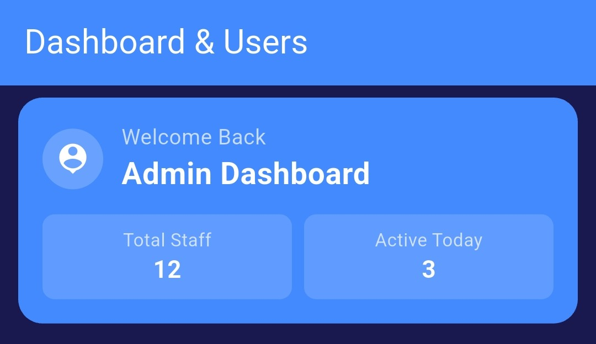

# Team Dashboard and Staff Management UI

A responsive Flutter user interface designed for a staff management dashboard. This project demonstrates clean UI structure, reusable widget design, and effective layout composition using Dart and Flutter Material Library.

## Features

- Welcome Header: Displays dashboard overview and staff summary statistics.
  
- Search Interface: Integrated search bar layout for team member filtering.
- Category Filters: Scrollable filter chips for segmenting employees by role.
- Dynamic Staff List: Efficient ListView implementation displaying employee details and positions.
- Action Navigation Bar: Bottom action panel for adding new team members.
- Clean Code Structure: Modularized widget methods ensuring high readability and maintainability.
